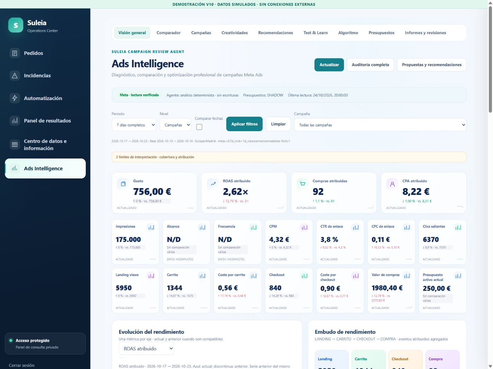

# V10 · Acta de aceptación de desarrollo

**24 octubre 2026 · No desplegado.** Todas las cifras de las capturas son
simuladas. Los agregados productivos de la auditoría se documentan por separado
en [ADS_INTELLIGENCE_V10.md](ADS_INTELLIGENCE_V10.md).

## Ejecución final

- **1.264/1.264 pruebas**, 137 archivos, cero fallos, cancelaciones u omisiones.
- Linux/Node22 con PostgreSQL17.5 efímero por socket Unix. `--network=none`, raíz
  de contenedor de solo lectura, sin secretos ni credenciales de producción.
- Duración: 157.548,85 ms. Mismo umbral de rendimiento original, ejecución
  secuencial sobre una CPU para evitar competencia artificial entre suites.
- SHA256 del archivo de fuente aceptado:
  `4ff539e4e1ded28116c4a0bb958bf9064b6e64767072d74fdd45154c8daea630`.
- Acta y log privados del contenedor:
  `/var/tmp/suleia-v10-qa-4ff539e4e1/result.json` y `tests.log`.
- Los contenedores y volúmenes temporales PostgreSQL se eliminaron al terminar.
  No se reiniciaron contenedores productivos ni el bot.

Las pasadas anteriores no se presentan como éxitos: la primera detectó un mock
de DOM sin `document.querySelector`, que se amplió con comprobación del drawer
V10 y reanudación del refresco; otra pasada paralela excedió el umbral original
del test de 2.000 pedidos al competir por una CPU. No se alteró el algoritmo de
pedidos ni ese umbral. La pasada final secuencial superó también ese test.

## Cobertura funcional y de seguridad

| Área | Evidencia ejecutada |
|---|---|
| Embudo | Etapas ausentes; cero/denominador pequeño; población incompatible; etapa mayor al padre; compra con checkout cero; caída comparable válida |
| Métricas | CPA/valor/ROAS ausentes o ambiguos; agregación ponderada; no sumar alcance/frecuencia; huecos sin ceros |
| Clasificación | Pocas compras, contexto no verificado, fuente antigua, día/semana mala con mes bueno, deterioro repetido, aprendizaje/cambios recientes, fuentes opcionales independientes |
| Periodos | Madrid, ventanas completas 3/7/14/30/60/90, personalizados, bases equivalentes, hoy parcial; histórico sin acciones actuales |
| Preparación | Coalescencia, respuesta202, mismo trabajo al reintentar, caché acotada y fuentes opcionales fallidas |
| OAuth/API | 401 sin sesión, GET-only, no suplantar principal/actor, roles de Telegram, sin transferencia de autoridad presupuestaria |
| Journal | Digest cambiado rechazado, actor inválido, evidencia congelada, duplicados idempotentes, evolución posterior separada y no causal |
| SQL objetivo | Fechas Madrid durante DST, corte de madurez, duplicado canónico y pruebas excluidos, confirmaciones de cohortes antiguas, entradas futuras excluidas, salida solo agregada |
| Objetivo | Muestra pequeña/inválida, tasa cero, pesos diarios diferentes, escenarios ordenados, CPA sostenible/presupuesto N/D |
| Contenido | Nombres maliciosos inertes, imágenes no seguras/credenciales/URL ausente rechazadas, sin enlace fantasma `/undefined` |
| Instantáneas | Una fila o hijo de otro periodo nunca sustituye el informe original; acciones históricas deshabilitadas |
| Telegram | Fallback determinista, cuatro partes y tamaño válido, locks/claims, orden, un solo envío por fecha, UNKNOWN bloqueado, reinicios, DST25oct22:30Madrid |
| V5.1 | Suite completa de política, límites, transporte, reservas, idempotencia, learning y ejecutor; 19 hashes protegidos iguales |
| Regresión | V3/V4/V6/V8, pedidos, incidencias, descuentos, readonly SQL/MCP, finanzas y COGS, analítica, AppShell y login |

Además, el cierre de la suite de panel antes del último caso añadido pasó
61/61 en Windows. El nuevo caso de instantánea por periodo pasó en el conjunto
de cinco pruebas UI de crecimiento y está incluido en las **1.264 finales**.

## Prueba visual local real

Chrome mediante la excepción local de navegador ya autorizada. El harness
utiliza `createReviewService` y su `growth` reales sobre fixtures sintéticos;
no sustituye esos servicios por JSON de diseño. Solo el transporte OAuth local
y las fuentes se simulan. Banner visible y nombres DEMO. Ninguna llamada Meta,
Shopify, Dropea, Telegram o OpenAI desde ese entorno.

| Comprobación | Resultado |
|---|---|
| Desktop1440×1080 | Cuatro KPIs principales, 18 totales, cinco prioridades, cuatro etapas principales, sin overflow de página |
| Tablet834×1112 | Dos columnas principales; lectura y drawer adaptables, sin overflow de página |
| Móvil390×844 | Menú plegable, filtros abrir/cerrar, KPIs de dos columnas, drawer del ancho del dispositivo, sin overflow de página |
| AppShell | Los seis botones conservan el mismo componente y selección activa al navegar por los seis módulos |
| Login | Entrada por login local vuelve a `#ads`; las pruebas de OAuth verifican PKCE, vuelta, expiración y refresh sin modificar autenticación real |
| Campaña | ID101, comparación temporal y anuncios propios; guardar observación muestra éxito e historial, cero acciones Meta |
| Conjunto | ID201 y ID203 verificados; anuncio hijo corresponde al conjunto y fechas seleccionados |
| Anuncio | ID3010 e ID3030 verificados; miniatura local DEMO, propuesta de presupuesto deshabilitada |
| Embudo | Carrito ordena primero los dos anuncios de Sérum con caída observada115,5 eventos cada uno, frente a cero de los demás |
| Personalizado | 1–7octubre se propaga al drawer y bloquea registrar decisión/preparar propuesta como acción actual |
| Muestra insuficiente | Conserva N/D y motivos; no se fabrica una decisión de eficiencia ni habilita ejecución |
| Refresco | Los tests conservan el mismo modal abierto y reanudan el refresco tras cierre, sin impedir la actualización explícita |
| Consola | Cero errores JavaScript en la verificación final de la aplicación |

El primer arranque del harness no declaraba la capacidad V7 y entró en la ruta
legacy; se corrigió la configuración de **prueba**, sin cambiar flags de
producción. También se unificó el GET y POST de evidencia del harness bajo el
mismo servicio, en vez de comparar dos variantes de fixture con distinto campo
`force`. Estos fallos de preparación local no se atribuyen al runtime productivo.

Una captura full-page excedió el tiempo del navegador; no se presenta una
imagen de carga como prueba. Se entregan vistas reales del viewport y capturas
separadas del análisis ya cargado. Las capturas de los módulos ajenos demuestran
el menú común en un escenario local vacío, **no verifican sus cifras reales**.
La regresión financiera real quedó documentada y desplegada en PR145/146.

## Capturas revisables

- [Embudo y series](assets/ads-v10/funnel-and-trends.png)
- [Prioridades y objetivo comercial](assets/ads-v10/daily-decisions.png)
- [Contribución a una caída del embudo](assets/ads-v10/funnel-contributors.png)
- [Análisis de campaña](assets/ads-v10/campaign-analysis.png)
- [Análisis de conjunto](assets/ads-v10/adset-analysis.png)
- [Análisis de anuncio](assets/ads-v10/ad-analysis.png)
- [Móvil](assets/ads-v10/mobile-dashboard.png)
- [Análisis móvil](assets/ads-v10/mobile-analysis.png)
- [Menú móvil](assets/ads-v10/mobile-menu.png)
- [Tablet](assets/ads-v10/tablet-dashboard.png)
- Menú compartido: [Pedidos](assets/ads-v10/menu-orders.png),
  [Incidencias](assets/ads-v10/menu-incidents.png),
  [Resultados](assets/ads-v10/menu-results.png).

Respecto a la referencia aprobada: superficies blancas con azul tenue, iconos
azules/verdes/violetas, tipografía oscura, jerarquía de cuatro KPIs y líneas
basadas en datos. Se añaden los controles de cobertura y N/D necesarios; las
cifras de la imagen de referencia no se copian como datos reales.

## Qué no acredita la aceptación de desarrollo

La aceptación aislada anterior no acredita despliegue V10, compras causadas por anuncios, deduplicación Pixel/
CAPI, EMQ, margen/CPA confirmado por campaña, presupuesto sostenible o una
modificación presupuestaria real. La conexión comercial solo acredita los
agregados y la limitación de duplicidad descritos en la auditoría. Ninguna
revisión ni smoke de V10 ha enviado mensajes a clientes o soporte.

Los artefactos, la comprobación de cambios concurrentes, los backups privados
frescos y el rollback para una futura aprobación se describen en el
[plan de despliegue](ADS_INTELLIGENCE_V10.md#artefactos-y-procedimiento-de-despliegue).

## Comprobación de producción autorizada · 24 de octubre de 2026

El propietario aprobó posteriormente el despliegue y una excepción limitada a
la comprobación visual de V10 en producción. No se reutilizó la autorización
local como permiso implícito. La sesión personal, inicialmente en espera según
el usuario, terminó de volver a Pedidos con datos; no se cambiaron autenticación,
credenciales o roles ni se inspeccionaron cookies/tokens.

API7224c11 saludable a20:50:15UTC. La verificación a20:51:41UTC contrastó21hashes
de runtime, nueve recursos publicados HTTP200/no-store, salud pública y versión
interna exacta. Growth/journal/finance/incidents respondieron401 sin OAuth.
El verificador inicial suponía incorrectamente pública `/operations/version`;
el proxy la trata como recurso estático404. Solo se corrigió ese smoke privado
para usar `/version` dentro del contenedor; no se cambió el proxy ni el producto.

| Comprobación real | Evidencia |
|---|---|
| Shell seis módulos | Pedidos, Incidencias, Automatización, Resultados, Centro de datos y Ads cargaron con la navegación común |
| Pedidos | 16 pendientes y resumen cargados; no se ejecutó ninguna acción de pedido |
| Incidencias | 15 pendientes,13revisión humana,2simulación; estados/filas/formato cargados, con avisos de frescura conservados |
| Automatización | 3workflowsLIVE y protecciones/cobertura visibles; no se confunde ese indicador con resolución autónoma general |
| Resultados octubre | Tarjetas, gráficas, histórico diario y TOTAL DEL MES presentes;33/33controles, coste de producto426.90EUR conservado |
| Fuente financiera observada | Ingresos6063.01, costes6921.08, beneficio provisional-858.07EUR, Meta3733.33; corte de fuente19:57UTC, aviso de datos atrasados. No se forzó una nueva generación |
| Centro de datos | Periodo25sep–24oct,484pedidos, filtros/productos y datos cargados |
| Visión general V10 | 18KPIs, gráfico/embudo, objetivo55/40, calidad de medición y tabla presentes |
| Campaña filtrada | CollaL12,17–23oct: gasto207.12,25compras, ROAS3.49, CPA8.28,601landing,66ATC,63checkout; gráfico y ratios basados en estos eventos |
| Objetivos comerciales | Primera lectura28/21/22; posterior29/23/24 al avanzar la fuente. Cohorte madura374/293 y NOT_ASSESSED permanecieron explícitos |
| Drawer campaña | NIDA_L1Copia:44.42EUR,7compras,ROAS5.69, periodos3/7/14/30etiquetados, anuncios propios e historial consultados |
| Conjuntos | Filtro de nivel cargó seis conjuntos de CollaL12, con métricas y estado de muestra propios |
| Drawer conjunto/anuncio | Conjunto120258145914780212 y su anuncio120258145914730212:102.63EUR,17compras,ROAS4.81,39ATC,37checkout; periodos e historial de presupuesto separados, sin atribuir causalidad. La ausencia de miniatura se declara |
| Informes | Programación22:30Madrid activada, siguiente25oct22:30, un destinatario; cinco informes históricos visibles, sin generar/enviar otro |
| Historial/escrituras | No se guardó observación, decisión o propuesta de prueba ni se envió un informe extraordinario |

Las consultas nuevas mostraron202 y preparación mientras reutilizaban el lector
canónico; campaña, conjunto y anuncio terminaron de cargar sin otra sesión de
autenticación. Los cambios de selector aplican su consulta automáticamente; no
se reinterpreta un botón transitorio ausente durante la carga como fallo del producto.

La cobertura agregada de eventos Meta es parcial: al incluir entidades con
eventos ausentes, compras/ROAS/CPA globales aparecenN/D. Una campaña con cobertura
sí muestra sus cifras. No se imputan ceros ni se oculta el aviso de histórico:
la última lectura canónica observada fue20:50:45UTC y las decisiones dependientes
de frescura se bloquearon después. Esta acta no acredita frescura continua de
Meta, Pixel/CAPI/EMQ ni atribución por pedido. No se realizaron escrituras Meta.

Los19hashes presupuestarios, entorno de políticas, botPID/config, tarifas,
contenedores ajenos y archivos estáticos fuera del overlay se mantuvieron.
Render d175378 saludable y V5.1LIVE autorizado. Ocho partesSENT de dos días, un
destinatario; las cuatro de hoy se completaron antes del despliegue y no se
reenviaron. El último slotCOMPLETE20:45UTC no prueba una escritura presupuestaria.
Backups, autorizaciones y recibos completos permanecen privados en
`/root/suleia-ads-v10-deploy-20261024/7224c11/`. Las capturas productivas se guardan
solo en el workspace privado; las imágenes del repositorio siguen siendoDEMO.

### Resultado parcial del primer slot posterior

El slot23:00Madrid terminóFAILED antes de propuesta, con cero propuestas u
operaciones nuevas y cero pendientesUNKNOWN/EXECUTING. La auditoría posterior
identificó `META_RATE_LIMITED`: `readDelivery()` devolvióHTTP400/17/2446079;
cuenta y campañas respondían. Se detuvo el diagnóstico antes de leer Insights.
La vista de Presupuestos informó que no podía verificar datos actuales. No se
reintentó el slot ni se afirmó ejecución/cero gasto a partir del recibo genérico
`externalWrites=null`. El despliegue y la UI están verificados en el alcance
anterior; **no se acredita funcionamiento continuo del automatismo durante ese
límite del proveedor**. La cuota no se sortea con otro token/lector, un reset,
una relajación de guardas ni una restauración que provocase más lecturas frías.

### Corrección del gráfico detectada en producción

El SVG de evolución contenía sus trazados, pero el estilo legado `#ads-view svg`
lo reducía a19×19px. Se corrigió la especificidad de gráfico, sparklines e iconos
solo dentro de V10. Las62pruebas de panel pasaron sin omisiones; la validación
aislada1264anterior sigue describiendo el candidato original. No se presenta
esa suite anterior como una repetición sobre el CSS posterior.

Commitb048ad5, montaje `/opt/suleia-panel-releases/ads-growth-svg-b048ad5`, publicado
21:13:24UTC. API7224c11/PID de contenedor sin cambios, bot/entorno y19hashes de
presupuesto iguales; resto de estáticos y contenedores sin cambios. El servidor
publicó el CSS con su hash normalizado6baf7481…19073. No se cambió la API para
corregir un tamaño de gráfico ni se reactivó una revisión fallida.

Después de recargar el CSS publicado, el SVG real pasó de19×19 a567.56×186.69px,
con seis trazados, y las sparklines recuperaron su tamaño previsto. Capturas
privadas `output/ads-intelligence-v10/production-v10.png` y
`production-v10-chart.png`: indicadores, líneas actual/anterior con huecos y
embudo de CollaL12 visibles. Consola sin erroresJavaScript. No se subieron estas
capturas con métricas reales al repositorio.

Cierre de solo lectura21:15:59UTC: API saludable, bot activo,19hashes/flags sin
cambios, montaje estático nuevo correcto, Render d175378 saludable y8SENT sin
reenvíos. El siguiente slot normal23:15Madrid también terminóFAILED; no fue un
reintento del23:00. Por tanto, el despliegue visual está comprobado y el límite
del proveedor continúa pendiente; no se declara el automatismo reparado.
