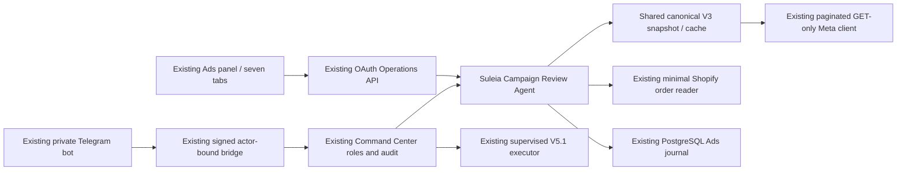

# Ads Intelligence V6 — implementation and release review

Status: development implementation, **not merged or deployed**. Based on
`b9e8e4bc5966af894e69e54f413acad8d2357488` (PR #134). V6 does not activate,
deactivate or amend the separately approved V5.1 LIVE budget policy.

## Architecture

The review service receives no writer, Telegram sender or scheduler. No second
panel, bot, database, Meta client, authentication system or budget executor is
created. It extends `#ads-view`; the V3 summary and V5.1 budget view remain
available. The latter continues to display its real operating mode.

### Backend

`services/meta-ads/review/` contains:

- `periods.mjs`: Madrid calendar windows (today, yesterday, complete
  3/7/14/30/60/90 days, custom and custom baseline), compatibility checks and
  completed-hour traffic comparison. DST changes, absent hours, overlap,
  unequal duration and partial conversion comparisons cause abstention.
- `analyze.mjs`: canonical metric aggregation, hierarchical/manual/product
  selection, descriptive CPA/ROAS factor identities, coverage, sample/maturity,
  traffic/funnel/measurement hypotheses, persistent fatigue and contextual
  rankings. Each recommendation includes source, cut, evidence, alternatives,
  confidence, priority, risk, action and validation.
- `statistics.mjs`: Wilson intervals only for explicitly justified independent
  binary trials; approximate fixed-horizon sample planning; exploratory MAD
  outliers; BH/BY correction for supplied valid test families. Nonunique event
  aggregates get no invented binomial significance, CPA/ROAS interval or causal
  claim. The deployed review does not calculate significance from arbitrary
  attributed-event ratios.
- `experiments.mjs`: internal experiment design, sample requirements, stop
  conditions and aggregate result recording. A design is not an external Meta
  experiment. Insufficient sample/horizon yields INCONCLUSIVE. Even a complete
  supplied test requires review and does not select an automatic winner.
- `commerce.mjs`: minimal, aggregate-only output from the existing order reader;
  no contacts/conversations, inferred campaign attribution or settled-profit
  claim. Browser-session events are unavailable from that production reader.
- `queries.mjs` / `service.mjs`: one deterministic answer engine for panel and
  Telegram. No external model, API key, inference charge or prompt transfer.
- `policy.mjs`: versioned sources/formulas and separate internal review criteria.
  The V3 diagnostic sample (EUR 15 / 1,000 impressions / five purchases / 30
  funnel events) remains distinct from V5.1's approved three-purchase budget
  criteria. Review materiality (20%), maturity (seven observed days) and alert
  cooldown (24h) are internal criteria, not Meta rules or spend authorization.

`runtime.mjs` shares the existing V3 range cache and coalesced in-flight jobs.
Cold canonical reads retain the existing bounded response and preparing/retry
behavior. Provider failure preserves the actual extraction time, marks fallback
stale and suppresses V6 recommendations/rankings. The cache retains at most eight
reports and evicts older entries above 40,000 combined fact rows (one large
report may remain). Optional evidence has a separate bounded cache on the same
reader; it does not cache last-moment budget validation reads. Pagination,
allowlisted Graph hosts, concurrency, rate-limit retries and request limits
remain centralized in the existing transport.

Only V6 can opt into bounded 90-day Insights reads. Existing V3 period validation
and the budget executor retain their limits. Optional video, device, placement
and country reads are lazy and explicitly unavailable on incompatible/error
responses. Activity context over long periods is labelled as limited to the
last 31 days. Current entity status/budget is not historical status/spend.

### Panel

Overview, Comparador, Diagnóstico, Creatividades, Oportunidades, Test & Learn and
Presupuestos share one existing view and API. Features include manual selection
of up to five campaigns (configuration permits 2–10), hierarchy drill-down,
metric charts with gaps, weighted period comparisons, custom dates/baseline,
verified-product filtering, thumbnail/video evidence, contextual rankings,
internal review decisions, experiment design and paginated journal. Unknown
product links are not inferred from names; ranking contexts are kept within
their campaign when product identity is unknown.

The panel never submits a budget mutation. The agent question box uses the same
service, evidence digest and timestamps as Telegram. Existing budget requests,
confirmations, private actor checks and roles retain their original routes.
V6 Telegram questions/follow-ups retain actor-scoped context and decision audit.

### Persistence and alerts

No migration or additional SQL grants are required. V6 uses typed JSON records
in the existing append-only `economics.ads_algorithm_journal` under its current
CHECK constraints and SELECT/INSERT role. V4 journal reads exclude these typed
V6 records, so its renderer retains its contract. V6 history is cursor paginated.
Evidence digests, authenticated principals, reference validation and deterministic
record IDs provide audit/idempotency. A changed digest blocks a panel decision.

False-positive / observe / internal approval decisions do not change policy.
Alert keys exclude period boundaries; cooldown checks use the latest matching
record, with a transaction advisory lock to prevent concurrent duplicate
observations. No alerts are sent. Daily/weekly/monthly profiles are callable
under existing auth and marked PREPARED_ONLY, unscheduled and notifications off.

## Endpoints (existing Operations auth)

| Method | Path under `/api/operations/ads-intelligence` | Behavior |
|---|---|---|
| GET | `/review` | canonical review, comparison and drill-down |
| GET | `/review/query?question=...` | shared deterministic explanation |
| GET | `/review/records?cursor=...&limit=25` | append-only history |
| POST | `/review/records` | REVIEW / DECISION / EXPERIMENT / EXPERIMENT_RESULT / ALERT_OBSERVATION |
| GET | `/review/alerts` | deduplicated internal alert candidates, no sends |
| GET | `/review/audit?profile=daily\|weekly\|monthly` | on-demand prepared audit |

V6 responses explicitly report zero Meta budget writes, including when the
existing budget service runs LIVE. POST authenticates the principal server-side;
body-supplied actor identity cannot impersonate it. All other methods are rejected.
The existing signed Telegram bridge accepts the read-only `review` action and
routes qualifying natural questions to the same service. It does not add a
second Telegram transport.

## Sources and measurement limitations

Knowledge version `meta-knowledge-2026-10-22-v1`; actual production Graph version
verified as v25.0. Source access is recorded honestly, including failures:

| Source | Review result and use |
|---|---|
| [Meta Insights](https://developers.facebook.com/docs/marketing-api/insights/) | Fetch returned HTTP 429; not claimed as fully reviewed. |
| [Meta's Postman collection](https://www.postman.com/meta/facebook-marketing-api/folder/zzd6d5p/insights-api) | Landing shell accessible; operation bodies unavailable. |
| [Official Python SDK v25.0.0](https://github.com/facebook/facebook-python-business-sdk/tree/39ca02c3b492222c26ba2fd08d5414af51d4f781) | Pinned field/enum source, including video/breakdown fields; does not guarantee every combination is supported. |
| [Meta measurement update, 3 March 2026](https://about.fb.com/ltam/news/2026/03/simplificando-la-medicion-de-anuncios-para-un-mundo-social-first/) | Reporting changes and incrementality guidance; rollout timing for this account is unknown. |
| [A/B, creative and lift studies](https://formedia.facebookblueprint.com/student/path/219763-ab-test-conversion-brand-lift-course) | Course outline, not complete lesson content. |
| [Creative formats](https://www.facebookblueprint.com/student/activity/707402) | Outline on diversification, not a universal fatigue threshold. |
| [Diversified creative](https://www.facebookblueprint.com/student/path/253130-increase-campaign-performance-with-diversified-creative) | Concepts/motivations/formats; observation remains a hypothesis. |
| [Meta Conversion Lift](https://certifications.facebookblueprint.com/student/page/674272-measure-channel-impact-with-meta-conversion-lift) | Outline; attributed ROAS is not incremental lift. |
| [NIST proportion intervals](https://www.itl.nist.gov/div898/handbook/prc/section2/prc241.htm) | Binomial intervals require defensible trial assumptions. |
| [Benjamini–Hochberg original paper](https://academic.oup.com/jrsssb/article/57/1/289/7035855) | Abstract/assumptions reviewed; supplied dependent test families receive conservative BY adjustment. |
| [Benjamini–Yekutieli, authors' university record](https://cris.tau.ac.il/en/publications/the-control-of-the-false-discovery-rate-in-multiple-testing-under/) | Abstract supports the conservative dependence correction; the linked full-paper fetch was unavailable. |

Official facts, internal diagnostic criteria and case hypotheses are separate.
ROAS = summed attributed value / summed spend; CPA = summed spend / summed
purchases; CTR/CPC/CPM also come from sums, never averages of entity ratios.
Overlapping Purchase aliases are selected once. Missing/ambiguous purchases do
not become zero. Unique reach/frequency are not added across days. A mixed
click/view purchase-to-click quotient is only an algebraic proxy; decompositions
do not identify causal contribution. Partial-day comparisons and attribution lag
are disclosed. Product/customer margin is never assigned from names or dates.

## Verification

Final Node **22.22.0** isolated suite: **298 passed, zero failed/skipped**.
Includes 47 V6 analytical/safety tests, real PostgreSQL migrations 054–058 in an
ephemeral database, journal pagination/idempotency/cooldown races, OAuth/bridge
and actor-role checks, Telegram context, and V3/V4/V5.1 regression coverage.
No production database URL or token was passed to QA. Containers had no network;
PostgreSQL used only a temporary shared Unix socket. Test containers and socket
volume were removed afterwards.

`scripts/ads/review-v6-visual-check.mjs` ran with the owner's existing local Ads
browser-QA exception: 1440×1080 desktop and 390×844 mobile, localhost only,
external requests blocked, zero browser errors. It checks two/five selections,
metric changes, detail, dates, mobile overflow, internal decision/experiment,
shared questions, budget-tab navigation/return, untrusted text and source failure.
Fixture screenshots are **local QA data, not proof of production deployment**:

- [Desktop comparator](assets/ads-v6/desktop-comparator.png)
- [Mobile overview](assets/ads-v6/mobile-overview.png)

Mapping of the requested 36 scenarios: analytical tests 01–34 cover the named
business cases; 29/30 and existing transport tests cover partial failure/rate
limits; the complete regression suite covers V3/V4/V5.1; local browser scenarios
cover 35/36. Earlier failures (stale fallback after forced refresh, an SVG icon
CSS collision, fixture selectors/configuration) were corrected and rerun.

## Release and rollback — approval still required

1. Review this PR and its dependency #134. Do not merge either automatically.
2. Obtain approval for merging/deploying V6 API/panel/bot. No migration is needed.
   Record the current image, panel assets and bot checkout before deployment.
3. Deploy the immutable reviewed revision with `ADS_REVIEW_V6_ENABLED=false`.
   Keep every existing V5.1 LIVE authorization, limit and scheduler unchanged.
4. Separately enable `ADS_REVIEW_V6_ENABLED=true` and expose the matching
   `ads_review_v6_enabled` config. Default `ADS_REVIEW_MAX_CAMPAIGNS=5`.
   Configure `ADS_REVIEW_PANEL_URL` with the verified HTTPS panel root for the
   required Telegram deep links (no credentials/query/hash in the configured URL).
   No model key or additional Shopify/Meta scope is requested.
5. Smoke-test authenticated review/records, both administrators' private signed
   queries, equal report digests, hierarchy and responsive view. Verify V5.1
   schedule, policy, account locks and unresolved-operation protections remain.
6. Any external experiment, campaign edit, new report schedule/Telegram send,
   measurement configuration change or additional commercial attribution needs
   its own scope/approval. None is enabled by this implementation.

Rollback: disable only `ADS_REVIEW_V6_ENABLED`, restore the captured API/panel/bot
revision if necessary, and retain the append-only journal. There is no destructive
database rollback or down migration. Do not set the entire Ads runtime SHADOW or
disable the already-authorized V5.1 LIVE policy as a V6 rollback shortcut.

Remaining limits: session analytics are not wired into the server reader; the
one-off ShopifyQL reconciliation in the audit is not a new scheduled integration.
Validated campaign/product/order/cost linkage is absent. Creative screenshots
do not assess pixels automatically, and unsupported video/breakdown data stays
unavailable. Observational thresholds are review aids; causal recommendations
require a separately approved controlled design.
