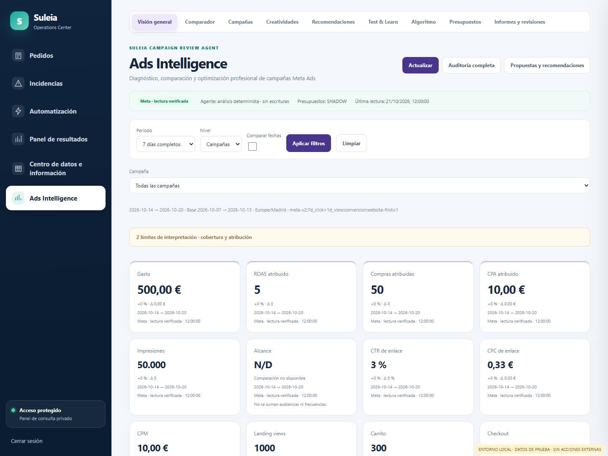
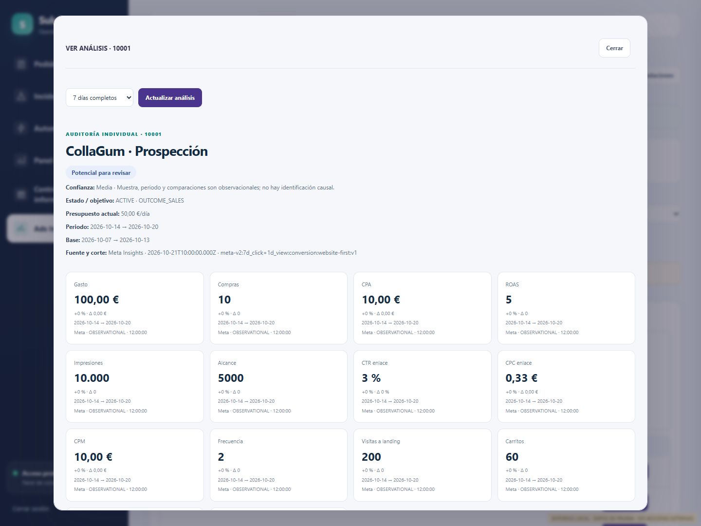
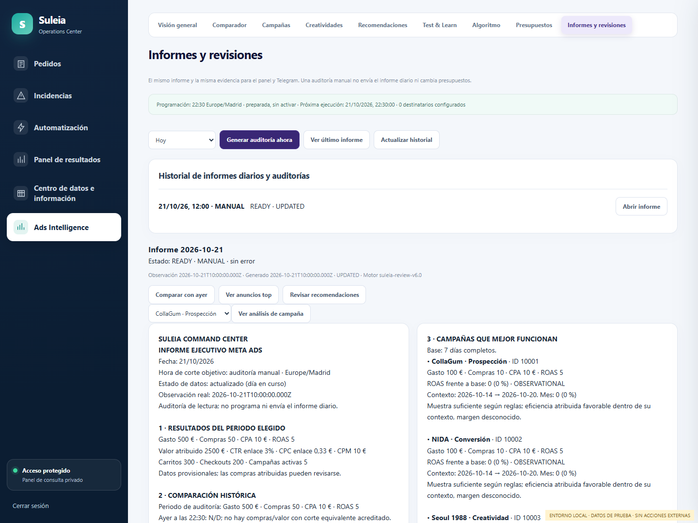
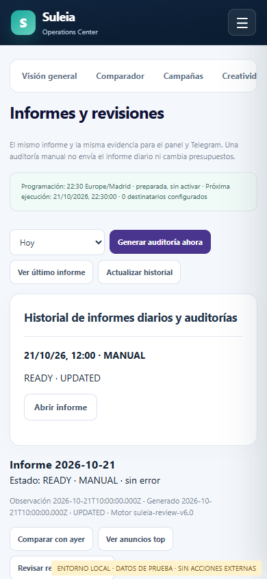

# Ads Intelligence V8 — implementación y despliegue

Fecha: 23/10/2026. Integra V6, V7 y el informe ejecutivo V8. El propietario autorizó expresamente desplegar la revisión `20378bd5dd1fddb2ab3aa80bfb0ac07a14845528`, aplicar 059 y activar el informe después de superar las verificaciones. **API, panel, bot y migración están desplegados; el envío diario continúa desactivado mientras se verifica el acceso OAuth y la interfaz real.** Véase el [informe de despliegue](ADS_INTELLIGENCE_V8_DEPLOYMENT_20261023.md). No se han enviado pruebas a personas reales ni ejecutado cambios presupuestarios como parte de este trabajo.

## Estado y componentes reutilizados

La comprobación SSH inicial encontró API `suleia-bot-autopilot-reliability:c259413`, panel Nginx con el montaje anterior `budget-autopilot-live-e4d3b9d` y bot activo en `/opt/suleia-telegram-releases/reliability-c259413`. La PR #139 (V6) estaba en desarrollo; no se presupone fusionada. El candidato parte de PR #140 e integra sus arreglos de Telegram. La política V5.1 y su autorización LIVE de producción permanecen independientes.

Se reutilizan `services/meta-ads`, el lector Meta existente, el informe canónico, PostgreSQL, el motor Campaign Review Agent, el puente firmado, los roles de Command Center, el único consumidor de Telegram y `apps/review-panel`. No hay otro cliente Meta, bot, consumidor `getUpdates`, temporizador systemd ni ejecutor presupuestario.

## Fallos y cambios

1. La lectura canónica fría tardaba unos 19–22 segundos; el runtime esperaba cuatro segundos y confundía preparación con fallo. Ahora conserva un trabajo por periodo, devuelve `202 ADS_REPORT_PREPARING` y permite continuar la misma lectura. No se fuerza una segunda consulta en cada reintento.
2. Meta devolvió en la validación real HTTP 400, código 17, subcódigo 2446079, con señal de límite de consultas. Antes quedaba como `META_SOURCE_UNAVAILABLE`. Ahora se distingue `META_RATE_LIMITED`, con pausa compartida de 60 segundos entre periodos. Otros HTTP 400 conservan diagnóstico propio, sin reintento automático. Solo se guardan códigos numéricos, nunca el texto privado del proveedor.
3. El inventario de lectura de informes se comparte durante un máximo de 60 segundos y se reúnen consultas simultáneas. Insights conserva su contrato de frescura. El ejecutor conserva el lector original y sus lecturas frescas obligatorias: esta caché no decide ni autoriza presupuestos.
4. Las hojas CSS de Ads e Incidencias alteraban el menú exterior. Un AppShell centraliza seis secciones, iconos, anchura, colores, tipografía, estado activo, cierre de sesión y menú móvil.
5. «VER ANÁLISIS» conserva el ID exacto al cambiar fechas y muestra sus propios anuncios, embudo, descomposición descriptiva, evidencia, alternativas, confianza, propuestas e historial. La comparación de dos anuncios no se presenta como un experimento causal.
6. Los enlaces Ads ahora sobreviven al inicio de sesión y conservan pestaña, periodo e identidad. El histórico sigue accesible aunque una lectura actual de Meta falle.

Los errores de token, permisos, cuotas, contrato, identidad y SQL tienen diagnósticos distintos. Una actualización fallida conserva el corte anterior y marca los datos como históricos; no elimina controles de frescura. Tras reiniciar la API, las instantáneas en memoria deben volver a leerse; los informes guardados continúan disponibles en el historial SQL.

## Motor y contrato de datos

`createReviewService` sigue siendo el único motor de diagnóstico. El generador V8 recibe sus resultados de campañas y anuncios; no incorpora otro modelo de recomendaciones. Las reglas conservan su versión y cada informe guarda periodos, cortes, datos, huella SHA-256, recomendaciones, alternativas y riesgos.

- Contrato: `meta-v2:7d_click+1d_view:conversion:website-first:v1`, EUR, Europe/Madrid.
- ROAS, CPA, CTR, CPC y CPM se calculan desde importes y conteos del mismo nivel; no promedian ratios individuales.
- No se suman audiencias únicas, frecuencias, niveles jerárquicos ni alias duplicados de Purchase.
- Inventario sin Insights es desconocido, no cero. Una compra aislada no acredita un anuncio destacado.
- Comparaciones de 3/7/14/30/60/90 días completos, personalizadas y periodo anterior equivalente. Los datos disponibles determinan si cada comparación es válida.
- Hoy incompleto no se compara con ayer completo para compras/valor. Los desgloses horarios de tráfico no acreditan cohortes equivalentes de compra ni un corte exacto a las 22:30.
- Las hipótesis separan anuncio/tráfico, creatividad, web, checkout, medición y contexto. Cero eventos de checkout no demuestra una web rota. Sin `event_id` no se afirma deduplicación Pixel/CAPI.
- Shopify se mantiene agregado cuando el lector ya está conectado. Sus pedidos no se convierten en entregas, cobros ni beneficio atribuido. Sin enlace verificado pedido–campaña–costes, el margen por campaña es desconocido.
- Sin modelo externo. Un fallo o ausencia de un modelo narrativo no impide el informe determinista.

## Informe ejecutivo y Telegram

`services/meta-ads/executive/report.mjs` produce una sola representación persistida y cuatro mensajes accesibles con HTML escapado:

1. Cabecera, resultados del día y comparación semanal/mensual.
2. Campañas con señales favorables, deterioradas, recuperables o con potencial para revisión.
3. Hasta tres anuncios destacados y tres problemáticos, con métricas y enlace real.
4. Hechos, hipótesis, hasta tres acciones justificadas, estado real de Budget Autopilot y navegación.

Las clasificaciones indican su periodo. No se rellenan tres acciones si falta evidencia. No se usa «rentable» sin margen acreditado, ni se estima un impacto causal sin fundamento. Los mensajes tienen hasta 3.950 caracteres y no se cortan etiquetas HTML. Si hace falta se usa una presentación compacta conservando los diez bloques; la evidencia completa permanece en el panel.

Los botones de informe abren **la instantánea persistida**, con su ID y sección, después de autenticación. No llevan tokens ni credenciales en la URL. Revisar propuestas abre el ejecutor existente, con sus confirmaciones intactas.

Solo podrán recibirlo los IDs privados configurados expresamente, presentes en la allowlist existente y autorizados por sus roles para Ads y finanzas. No se concede nada por un username. El valor predeterminado de desarrollo deja la lista vacía y el envío desactivado. En el despliegue del 23/10 se verificó privadamente el ID del propietario contra la prueba de vinculación y se configuró ese único destinatario en API y bot. Juan permanece excluido del nuevo envío. Los dos administradores conservan sus permisos existentes.

## Programación y recuperación

La clase `ExecutiveReports` se ejecuta dentro del servicio Telegram existente, en una tarea asíncrona separada del polling. Objetivo: **todos los días a las 22:30 Europe/Madrid**, incluidos fines de semana. Se resuelven instantes locales, con ambos cambios de horario; no se fija una hora UTC permanente.

Ventana operativa: 22:30–23:00. Un reinicio dentro de ella reanuda una generación recuperable; fuera de ella registra `MISSED` y no envía recuperaciones tardías. Se registran el corte objetivo, observación real y generación. Los acumulados diarios observados después de las 22:30 **no se etiquetan como un corte exacto** de las 22:30. Las conversiones atribuidas siguen siendo provisionales.

PostgreSQL es la autoridad:

- ID diario determinista por cuenta y fecha local, con índice único adicional.
- Reserva de generación de cinco minutos, máximo tres intentos y protección contra resultados de una reserva antigua.
- Hasta dos generaciones simultáneas en el proceso; trabajos y lecturas acotados.
- Reserva independiente por informe, destinatario y parte. Las partes se envían en orden.
- Registro previo al envío, huella del contenido y recibo `message_id` para `SENT`.
- Solo un rechazo explícito 429 permite reintento, con espera y máximo tres intentos por parte.
- Fallos de red, respuestas ambiguas e interrupciones tras reservar quedan `UNKNOWN`/`SENDING`; no se reenvían solos.
- El estado local atómico del bot conserva recibos para reconciliar una pérdida del acuse SQL sin repetir Telegram. Un intento sin recibo exige revisión humana; Telegram no proporciona aquí una búsqueda retrospectiva que pruebe por sí sola la entrega.
- Estado técnico local y filas `FAILED`/`MISSED`, códigos de error e historial de entrega visibles para revisión. No se crean avisos técnicos a terceros.

El informe no espera al slot nocturno ni lo ejecuta. Su resumen presupuestario recibe **solo lecturas SQL y configuración**, sin `capture`, `constraints`, validadores Meta ni writer. Una reducción solo se describe como verificada cuando el ledger contiene su postcondición; las operaciones inciertas y alertas críticas siguen visibles.

## Panel y endpoints

Nueva pestaña **Informes y revisiones**: programación, próxima ejecución, historial paginado, detalle histórico, mensajes idénticos, evidencia diaria/semanal/mensual, recomendaciones y entregas por usuario/parte. Se conserva el registro existente de decisiones y experimentos. La auditoría manual permite seleccionar periodo y no usa la clave ni los carriles de envío diario.

Todos los endpoints del panel conservan OAuth y rol de operaciones:

| Ruta | Operación |
| --- | --- |
| `GET /api/operations/ads-intelligence/status` | Estado de fuente, latencia y errores seguros |
| `GET /api/operations/ads-intelligence/review` | Análisis canónico y auditoría individual por `campaignId` |
| `GET /api/operations/ads-intelligence/executive/history` | Programación e historial paginado |
| `GET /api/operations/ads-intelligence/executive/:id` | Informe persistido y entregas |
| `POST /api/operations/ads-intelligence/executive/generate` | Auditoría MANUAL; no envía Telegram |
| `POST /api/internal/ads-intelligence/command` | Puente ya existente; `executive-report` admite `due`/`finish`, con firma, ID privado y roles |

El POST de auditoría solo persiste análisis. El puente de entrega no constituye una autorización presupuestaria. Las respuestas de estas rutas declaran cero escrituras Meta.

## Archivos principales y migración

- Fuente/carga: `report-cache.mjs`, `report-reader.mjs`, `meta-ads-client.mjs`, `runtime.mjs`, API y cliente de informes.
- Motor compartido: `review/analyze.mjs`, `service.mjs`, `queries.mjs`, `campaign-audit.mjs`.
- V8: `executive/{report,service,ledger,schedule,budget-read}.mjs` y sus pruebas.
- Bot: `executive-reports.mjs`, servicio, gateway, configuración e instalador existentes.
- Panel: AppShell, auditoría individual V7 y `ads-executive-v8.js`; estilos y navegación centralizados.
- Migración **059** y rollback: dos tablas de informes/entregas; SELECT/INSERT/UPDATE para el rol Ads existente, lectura para operaciones/backup. Sin tablas de contactos ni permisos nuevos sobre pedidos.

## Validación reproducible

Las suites se ejecutan con Node 22.22, PostgreSQL 17 temporal por socket Unix, red desactivada y sin credenciales de producción. Cubren informes completos/parciales, sin compras, ROAS ausente, atribución ambigua, inactividad, muestras, rankings, CTR/CPC/carritos/tracking, Shopify ausente, ausencia de modelo, errores y duplicados Telegram, recibos perdidos, reinicios, DST, permisos, enlaces, HTML, tamaño, coexistencia nocturna, OAuth y regresión V7/V5.1.

La prueba visual `scripts/ads/review-v7-visual-check.mjs` usa Chromium/Chrome aislado **solo en localhost**, fixtures, una sesión ficticia y bloqueo de toda red externa. Verifica las seis secciones en desktop/móvil, nueve pestañas Ads, cinco campañas exactas, periodos, dos anuncios, columnas, cuota, error de credencial sin cerrar sesión, histórico accesible durante fallo y enlaces autenticados a informes. No usa un perfil ni sesión real.

La comprobación real se hace en una instancia temporal SHADOW, sin writer, con SQL `default_transaction_read_only=on` y guardia de métodos HTTP GET. No inicia API, scheduler ni consumidor. La evidencia final de ejecución y cualquier limitación actual del proveedor se registra en la PR y el Agent Hub; un resultado simulado no se presenta como una entrega ni cambio real.

Resultados finales:

- **531/531 pruebas**, 56 archivos, cero fallos y cero omitidas; Node 22 y PostgreSQL 17 aislado. La comparación de contenedores antes/después confirma que no se reemplazaron servicios productivos.
- QA visual desktop 1440×1080 y móvil 390×844: 44 peticiones locales, cero errores JavaScript, cero acciones externas. Incluye comparación de dos anuncios, columnas configurables e histórico accesible con Meta fallando.
- Lectura real terminada a las **09:05:05 UTC del 23/10/2026**: 32 campañas, campaña individual con sus cuatro anuncios correctamente acotados, historial de presupuestos disponible. Periodos semanal y mensual comparables; el informe retuvo exactamente los importes canónicos y la repetición conservó corte e importes.
- Informe real V8: cuatro mensajes de 1.516, 1.704, 1.376 y 2.891 caracteres, tres acciones respaldadas por el motor. Estado **PARTIAL**, sin ocultar las limitaciones del día en curso y de fuentes opcionales; no se afirmó un corte exacto a las 22:30. 82 solicitudes GET, SQL de solo lectura, cero mensajes Telegram y cero escrituras Meta.
- Comprobación productiva a las 09:07:57 UTC: API, montaje y release del bot originales, dos administradores con rol admin; la identidad del propietario sigue respaldada por la prueba de vinculación. Autopilot habilitado en LIVE y nuevo informe ejecutivo desactivado. No se aplicó 059 como parte de estas pruebas.

El rechazo de cuota se observó durante las primeras comprobaciones y la lectura posterior se recuperó. La recuperación observada no garantiza que Meta no vuelva a limitar consultas; los estados de cuota, espera e informe incompleto se han conservado y probado.

### Capturas de desarrollo

Datos sintéticos; no representan el rendimiento de Suleia.

## Procedimiento de despliegue autorizado

1. Releer Hub y verificar que no hubo otro despliegue. Registrar imagen/revisión API, montaje y hashes del panel, symlink/hashes del bot, flags y huellas de políticas/allowlists, sin copiar secretos a Git.
2. Backup SQL y estado privado del bot, incluyendo ledger de envíos. No borrar reservas ni offset Telegram. Verificar el ID receptor contra las pruebas ya existentes.
3. Aplicar 059 con rol de migración y verificar permisos mínimos. No requiere otra conexión SQL ni dar acceso a contactos.
4. Construir artefactos de la revisión aprobada; desplegar API/panel y release atómico del bot existente. Mantener `ADS_EXECUTIVE_DAILY_ENABLED=false` durante smoke tests. Activar `ADS_REVIEW_V8_ENABLED=true`, conservar la URL HTTPS privada del panel.
5. Smoke tests de OAuth, fuentes, carga fría, historial, auditoría manual y roles de ambos administradores. Sin envíos reales de prueba ni confirmaciones presupuestarias. Comparar los hashes de V5.1, políticas monetarias, servicios y temporizadores ajenos.
6. El propietario ya autorizó la activación condicionada a superar todas las verificaciones. Configurar el mismo único ID receptor verificado en API/bot y, cuando las comprobaciones estén completas, `ADS_EXECUTIVE_DAILY_ENABLED=true`. No tocar token, autorizaciones Meta, `AUTOPILOT_MODE`, límites ni horarios V5.1. No activar el informe comercial antiguo para conseguir este envío.
7. Verificar en la siguiente ventana el único informe de cuenta/fecha, destinatarios, huellas, recibos de sus cuatro partes y estado independiente del slot nocturno. No afirmar entrega hasta obtener los recibos; una incertidumbre se investiga sin reenvío.

### Rollback

Desactivar primero el flag ejecutivo en API y bot. Restaurar imagen API, montaje de panel y symlink anterior del bot mediante los artefactos registrados. Conservar tablas 059, reservas y recibos para evitar reenvíos al volver a activar. Conservar íntegro el ledger V5.1. El rollback SQL destructivo incluido es solo para un entorno de pruebas o una retirada aprobada tras exportar auditoría; **no** forma parte del rollback operativo habitual.

Estado de ejecución: pasos 1–4 completados; comprobaciones técnicas del paso 5 superadas, pero pendiente su comprobación autenticada de interfaz. El destinatario ya está verificado y configurado. La restricción de navegador de `AGENTS.md` impide completar esa prueba de producción sin la excepción solicitada o una comprobación manual del propietario. La autorización de despliegue y de activación condicionada ya existe; no se pide de nuevo. No se solicita autorización nueva para gasto: el informe no cambia presupuestos y no amplía la autorización LIVE existente.
