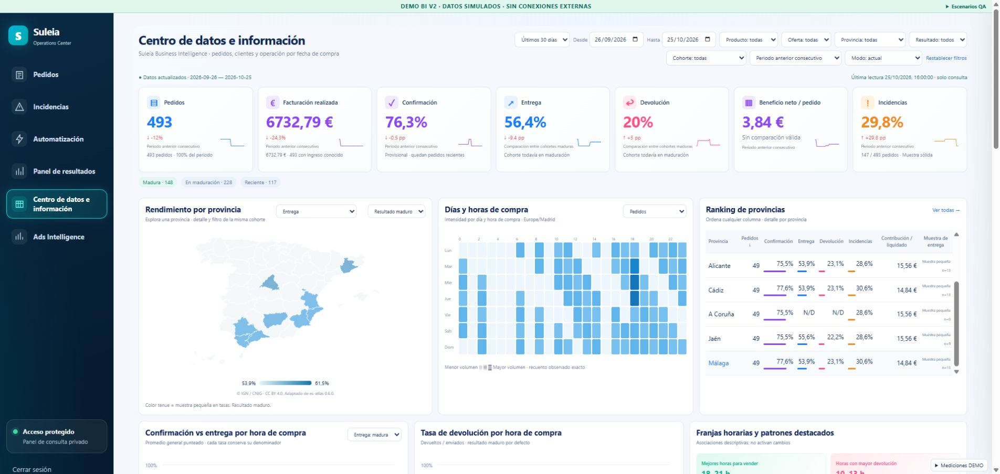
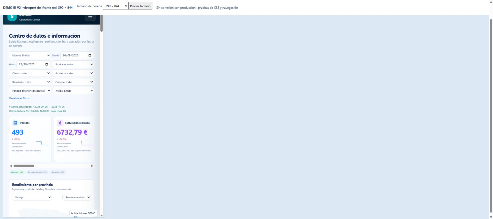

# Business Intelligence V2

The existing **Centro de datos e información** becomes a visual purchase-cohort
dashboard. It retains ORDER_INTELLIGENCE_AGENT, the existing analytics tables,
materializer, twelve MCP tools, filters, financial engine and private shell.
There are no customer/provider actions, budget-policy changes or new grants.

## Method corrections

Previously a generic order count described confidence even for delivery or
contribution, outcome deltas compared cohorts at different ages, absolute heat
counts showed confidence warnings, map clicks immediately changed the whole
report, and economic segments used ambiguous margin terminology.

V2 binds each metric to its denominator: confirmation/incidents/rejection and
absence use orders; delivery/return use sent; average recognized contribution
uses contribution_known. Orders and realized revenue are observed absolutes,
without confidence labels. Rate details include numerator/denominator and an
optional Wilson 95% interval. Sample quality is small below20, indicative20–49,
robust50+. No causal claim or automatic operational action follows an insight.

The current ALL-cohort outcome stays visible with a maturity note. Final-outcome
deltas and patterns compare MATURE against MATURE, with both denominators at
least20. Age is computed from purchase, regardless of a terminal result:
recent<7days, maturing7–20, mature≥21. Confirmation remains visible and provisional
when recent orders are still pending. Empty rate buckets stay null/gaps.
UI percentages round directly from canonical numerator/denominator, avoiding
double rounding (75/376 displays19.9%, not20% after an intermediate19.95).

Global net profit/order requires the existing financial projection's explicit
exactness flag, every date covered, and zero order-reconciliation difference.
Every segmented view instead shows contribution per settled order and coverage.
No Meta or overhead cost is allocated to province, product, offer or hour.

## Reconciled cut and owner decisions

The source audit at25Oct2026 10:52UTC for26Sep–25Oct found493orders,
376confirmed/sent,212delivered,75returned and147distinct incident orders.
Facts, cells and finance agree; missing costs0, reconciliation difference0.
Realized revenue6732.79EUR, exact net profit−1200.98EUR at that cut.
The owner approved this newer cut explicitly. The earlier screenshot487/373
remains a regression fixture; live data is never forced to those old totals.
Counts can legitimately grow, so post-deploy verification reconciles a fresh cut.

Comparison choices are contiguous preceding equal-length period, same dates of
the previous **month** (owner clarification), or none. Invalid month dates clamp
to the month's last day. Unequal durations do not receive a volume/revenue delta.
The original consecutive baseline contains560orders.

## Visual and interaction changes

Seven KPI cards and sparklines; Spain map with metric selector and inset province
details; sortable province ranking; seven-by24 heatmap; confirmation/delivery
lines, averages and gaps; hourly return bars; six descriptive highlights; funnel
and nonexclusive branches; return ranking/opportunities; contribution tabs;
product/offer tables; four compact crossed analyses; permanent maturity counts;
collapsed quality and sources. The sidebar is the unchanged V11 shell.

Map selection opens detail before explicit filtering. Province/hour/weekday,
product/offer, funnel and insight actions share the same filters and URL.
Hour bands default00–05,06–09,10–13,14–17,18–21,22–23 and can be configured only
as exhaustive nonoverlapping ranges. Cross filters retain structured keys.
Automatic panel refresh defers while the user studies a BI drawer, province
detail, expanded section or edits a filter. A failed read preserves the dated
last valid cut and its controls, with an explicit warning and retry.

Desktop uses the reference card layout, tablet two columns, mobile horizontal
KPIs, full-width map/heatmap and table cards. Cartography reuses the existing
CNIG/es-atlas asset and attribution; see tools/analytics/MAP-LICENSE.md.

## Evidence and performance

Focused tests cover both reconciled cuts, denominator7sent vs100orders, empty
rates, small observed counts, mature comparisons, prior-month dates, bands,
exact finance scope, ambiguous legacy stages, structured crosses, dense MCP
payload size, SQL coalescing, retained cuts and UI interactions.
The isolated Linux/Node22/PostgreSQL17 suite passed1307/1307 across144files,
zero skips, with networknone and no production credentials. Receipt source
archivebf93172ccb7ebf094e3aa93490ec6d663a494ba248e867acfe8f87f13734cdf3
covers the final runtime debef0f, including single-rounding and current/mature
drilldown fixes. The exact MCP image also passes6/6 contract tests as its normal
UID100, without network or secrets. All three image entry modules import asUID100.
An initial packaging attempt failed before activation because copied directories
were not readable to the application user. Automatic rollback restored healthy
original services; no business action occurred. Candidate imports now verify
explicit COPY directory permissions before any service update.

The warm CPU-only2000-order benchmark includes JSON serialization,3warmups and
20samples. On this Windows run, V11→V2 p95ms: overview92.98→210.60,
geography4.88→21.45, hourly8.02→23.93, patterns93.32→113.74. V2 computes more
partitions and remains within the requested engine budgets. These are synthetic
engine results, not an HTTP/SQL SLA or production before/after latency claim.
The performance gate measures actual warm p95, rather than naming a cold
five-run maximum a warm measurement. Projection reads remain batched, with
coalesced prepared overviews,30s snapshots and bounded caches; no N+1 queries.

Real Chrome QA used local DEMO data:52interactive province paths,168heat cells,
7KPIs; desktop1440 and normal1900+, tablet820, mobile390 CSS iframe viewports.
The1440/820/390 frames' document width equals scroll width; mobile KPIs scroll
internally and tables become cards. This is responsive CSS testing in a real
browser, not physical-device emulation. Map inset, filtering, comparator,
heat tooltip/drilldown, no-data gaps and simulated503 retention/recovery checked.
Captures are clearly synthetic and contain no customer data:

## Release and rollback

Only shared analytics modules/read service, the materializer version marker,
MCP filter registration and four panel assets are released. Each API/MCP/
materializer image overlays its own captured production base. The deployed
MCP object's privacy-sanitizer correction is preserved while adding only the
four filter-schema lines. Do not replace that file wholesale from another base.

Materializer version4 triggers one complete analytics reconciliation and rebuilds
the existing JSON cells/precomputes transactionally. This adds exact stage flags
for funnel filters; ambiguous mixed legacy cells fail closed until refreshed.
There is no schema migration, new table, user, SQL grant or financial formula.

Release gates preserve19budget files, all operational environment values,
botPID/config/token/admins, financial rates, unrelated container IDs and static
files. The shared deployment lock, quiet financial slot window and absence of
unknown/executing operations are checked. OpenAI remains0USD. No report/test
message or artificial canary is sent. Render is not redeployed.

Private release records live under
/root/suleia-business-intelligence-v2-deploy-20261025/<commit>/.
They capture original compose chains/environments, source hashes, images and
static mount. Rollback stops the new materializer, recreates only API/MCP/panel/
materializer with the captured original compose chain and removes only the new
BI override. The old materializer rebuilds its compatible projections. Never
restore historical SHADOW policy or touch canonical logistics/finance sources.
Final deployment evidence is recorded in BUSINESS_INTELLIGENCE_V2_DEPLOYMENT.md.
