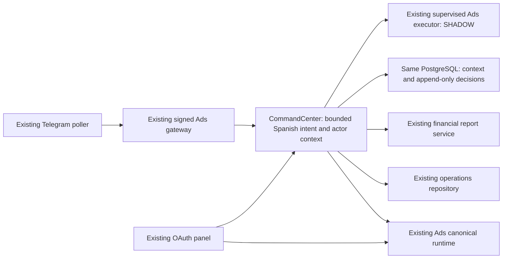

# Suleia Command Center 2.0 — review candidate, 21 October 2026

## Deployed and prepared work

The campaigns view is deployed from PR #122, revision
`f8e519b70bb174ab9daaf859ca4346ed9f3f9308`. Its public entry is
https://mcp.suleia.com/operations/#ads . Meta GET and SQL SELECT only;
`ADS_REPORT_READ_ONLY=true`; the existing SQL login remains read-only.
Authenticated production readback verified the canonical seven-day report,
both authorized actors, rejection of an unknown actor, OAuth requirement,
exact served assets and no-store caching. No new SQL login was created.

The existing Telegram service has two independently verified administrators.
The original account remains present. Verification used the single existing
poller and fresh private provider IDs; the owner then explicitly approved the
identified pending request. The approval and grant are audited privately.
Both actors passed equivalent campaign reads. Identifiers, challenges and
credentials are intentionally excluded from this document and GitHub.

The new 2.0 engine, ledger, business tools, panel cards and bot gateway changes
are a **development candidate**, not activated in production. Phase 9 of the
owner's specification requires approval. An automatic approval review also
rejected creating a persistent production SQL login without specific security
approval. The functional read-only deployment above resolves campaign display
without bypassing that restriction.

## Audited inventory and reuse

| Component | Observed state / reuse |
| --- | --- |
| PR #115 | Open prepared shared Ads/Telegram implementation; reused gateway and legacy safeguards |
| PR #116 | Open prepared VPS V3/V4 implementation; reused read client, canonical report, diagnostic engine, cache and single simulated executor |
| PR #121 | Published identity observer, deployed on the existing Telegram poller |
| VPS API/panel | Campaign read surface now deployed; old incident/finance/OAuth behavior and other container identities preserved |
| Telegram | One systemd service, one state directory and offset owner; unchanged bot token; two numeric allowlist admins |
| Meta | Live GET account/readback valid; EUR/Madrid; LIVE remains uncompiled and all real-write flags false |
| PostgreSQL | Existing operational database; additive Ads tables 054–056 present; existing API login defaults to read-only transactions |
| Finance | Existing panel repository and supplemental report client reused; monthly accounting and coverage, not inferred cash collection |
| Shopify | Existing authenticated read helper and recovery environment available; no duplicate importer or altered order |
| Dropea/Chatby | Existing operational projections/workers; this candidate adds bounded reads only |
| Hourly recovery / incident worker | Existing independent owners preserved; no timer, action logic or customer message changed here |
| MCP | Existing private OAuth/role boundary preserved; no new public tools or write grants |
| Render | Existing main deployment left unchanged; no unrelated merge/deployment |
| External model | Owner chose to continue without one; no API call, key creation or model dependency |
| Trendtrack | No verified server credential/adapter found; ChatGPT connector does not establish VPS access. Unavailable, zero calls/credits |

## Architecture

No second bot, database, Meta client implementation, logistics executor or
scheduled sender is introduced. The parser is bounded and deterministic;
it does not claim general language-model understanding. Unclear requests ask
for missing scope rather than infer a campaign, amount, date or permission.

Context contains only a read scope, campaign selector, period and level. It
expires after 15 minutes and is keyed to the existing private numeric actor.
It cannot authorize a new mutation. Complete budget requests and confirmations
go through the existing proposal engine, actor ownership, expiry, policy,
idempotency, fresh reads, locks, unknown-result reconciliation and audit.

Business tools whitelist response fields. No phone, address, customer message,
raw provider error or secret is persisted in the new context/decision ledger.
Order lookup requires one exact operational ID; an absent mirror record is not
proof of absence from Shopify. Finance displays month, coverage and freshness,
preserving nulls; profit is not allocated to a product/campaign without evidence.
Daily Meta, current operational queues and monthly finance remain labeled with
their distinct periods. A delivered order is not proof of bank settlement.

The executive brief handles partial source failures and consolidates priorities
by source/entity/cause. It is generated on demand. Existing alert digest
idempotency remains available; no timer, daily schedule, notification transport
or paid competitive query is enabled. Structured decisions are review evidence,
not self-modifying business policy or authorization.

## Roles

Existing numeric allowlist and private sender/chat equality authorize identity
before any tool. Optional role restrictions apply only after that gate; they
cannot grant access to a new ID. Both current users retain the default `admin`.

| Role | Candidate capabilities |
| --- | --- |
| admin | Ads/order/incident/finance/health reads, proposals, own confirmation/reconciliation, own decision history |
| analyst | Ads/finance/health/commercial reads, proposals and own history; no execution/confirmation |
| operator | Exact-order/incident/health reads; no Meta or financial mutation |

Current financial bounds remain 100 EUR/day **per campaign** and 10% per change,
with five-minute proposal expiry. The web panel keeps its existing separate
OAuth roles. Revocation removes the numeric ID from the existing bot allowlist
and signed-bridge actor configuration, restarts the single services and logs a
revocation while retaining the original owner and historical evidence.

## Phase status

| Phase | Status |
| --- | --- |
| 0 inventory | Executed; observed state and boundaries above |
| 1 architecture | Implemented by dependency injection and additive migration 057 |
| 2 conversation | Implemented bounded Spanish routing, clarification and per-actor expiry; no external model |
| 3 Meta | Existing V3/V4 integrated; simulated budget proposals reuse the existing executor |
| 4 business tools | Implemented masked order, incident, finance and health reads; Trendtrack runtime blocked by absent verified connection |
| 5 supervision | Existing policy/ownership/idempotency retained; restricted roles and per-user audit added |
| 6 reports/memory | On-demand executive brief, consolidated priorities and append-only decision memory prepared; scheduled sends inactive |
| 7 panel | Status, connections, report and proposal cards integrated into existing Ads view; candidate only |
| 8 QA | Executed tests and local responsive captures below; no production 2.0 canary yet |
| 9 deployment | Plan ready; explicit deployment and scoped SQL-login approval pending |

## Executed validation

- Linux/Node 22.22.0, network-disabled read-only containers: full VPS group
  **258 pass, 0 fail, 1 optional PostgreSQL skip**; bot/shared group
  **163 pass, 0 fail, 1 optional PostgreSQL skip**. Groups overlap.
- Final changed conversation/financial freshness group: **29 pass**, no skip.
- Separate PostgreSQL 17.5 Unix-socket-only integration: **pass**, no skip;
  migrations 054–057, persistence after a new ledger instance, actor separation,
  expiry, duplicate decision identity, locks, concurrent confirmation,
  append-only grants and zero simulated writer invocations. No production URL.
- Exact deployed read-only artifact: **19 pass**, no skip, under the existing
  non-root runtime. SQL snapshot writes and all ledger mutation methods blocked.
- Local Ads view: **1440×1050 and 390×844**, no JS errors, horizontal overflow,
  external browser requests, SQL writes or Telegram sends. The 2.0 status block
  is explicitly marked **LOCAL FIXTURE**; Ads uses a filtered private Meta
  capture. Screenshots/validation stay in private delivery output, not Git.
- Windows HTTP tests initially hit sandbox EACCES; those were not passes.
  Linux packaging omissions were corrected and actual tests rerun; no failures
  are hidden. Source directory traversal was normalized for the non-root image.

Reproduce with `node --test services/command-center/*.test.mjs
services/meta-ads/*.test.mjs services/meta-ads/budget/*.test.mjs
apps/api/*.test.mjs apps/review-panel/*.test.mjs`, and the existing Telegram
test group on its shared branch. `ADS_TEST_ISOLATED=true` only accepts the
hardcoded disposable `ads_v2_test` Unix-socket database. Local browser capture
requires `ADS_LOCAL_BROWSER_QA_AUTHORIZED=true` plus private snapshot/output
paths; every non-loopback browser request is blocked.

## Acceptance scenarios

| Requested scenarios | Executed evidence / limitation |
| --- | --- |
| 1 daily summary; 2 campaign; 3 all campaigns; 4 worst ad | Center routing/context tests and shared report/gateway tests |
| 5 CTR; 6 web; 7 checkout; 8 sample; 9 absent ROAS | Existing diagnostics/intelligence/report tests; weighted metrics and unknown values retained |
| 10 order; 11 incidents; 12 stale source; 13 incomplete profit | Whitelisted tool tests, not-found semantics, stale clocks and missing attribution |
| 14 follow-up | Actor isolation, 15-minute expiry, fresh shared report read |
| 15 request increase; 16 proposal only; 17 simulated confirmation | Existing executor, center delegation, isolated concurrent SQL test; no real writer |
| 18 reject; 19 repeat; 20 expire; 21 unauthorized | Existing intelligence/bot ownership and expiry tests plus new role tests |
| 22 external budget; 23 partial API failure; 24 duplicate execution | Existing budget revalidation and reconciliation tests, partial-source brief and SQL lock/claim test |
| 25 Trendtrack when connected | **Not executed against a connected provider**; absent verified runtime connection |
| 26 API credits | Unavailable-provider path verified at zero calls/credits; paid quotas/caching cannot be validated without a real adapter |
| 27 executive; 28 repeated alerts; 29 record decision; 30 history | Center partial-source/priority/dedup tests, existing digest tests, actor-bound append-only SQL history |
| 31 panel/Telegram consistency | Canonical cached-report test; both production bridge actors returned identical metrics. New bot gateway activation still pending |
| 32 logistics regression; 33 no unauthorized writes | Existing API/panel regression and unchanged unrelated container identities; network-isolated zero-writer assertions |
| 34 mobile navigation/design | Executed local Ads + 2.0 fixture capture; no production 2.0 browser session |

Tested channel examples (no messages sent): `Analiza NIDA` followed by `¿Y
ayer?` retains only the requesting actor's campaign; `Consulta incidencias`
returns the fixture's 5 pending/3 responded/2 blocked; missing profit stays
`no disponible`; `Prepara un aumento de 10 € ... hoy` delegates once to the
existing proposal engine and does not execute; another actor cannot confirm;
an expired context asks for scope; `Mis decisiones` returns only that actor's
history. These are executed test examples, not claimed production conversations.

## Deployment approval and rollback

Approval would cover the reviewed 2.0 API/panel/bot artifacts, migration 057 and
one dedicated **suleia_ads_api_login** in the same database. The new login would
inherit `suleia_ads_executor` on Ads/context/decision tables only, with SELECT
of the exact HMAC reference/status/timestamp columns used by the existing join.
It must not receive finance/order/customer-data writes. Its random password
must remain only in memory and protected active runtime configuration (0600),
never in output, Git, command arguments or backups. The existing API role keeps
`default_transaction_read_only=on`. Automatic security review rejected this
production security change without explicit approval; it has not run.

The reference read grant is limited to `market`, `store_id`,
`external_order_id_hash`, `lifecycle_status`, `created_at_utc`,
`confirmed_at_utc`, `delivered_at_utc`, `first_seen_at` and `observed_at` on
`read_models.integration_dropea_orders`. No contact columns are requested.
Production sample thresholds must be inspected and approved as business policy;
missing thresholds block proposals rather than acquire invented defaults.

After approval: preserve private schema/ACL metadata and current immutable
releases; verify new role privileges; provision the protected Ads pool; apply
057; enable `COMMAND_CENTER_ENABLED` with its approved dedicated pool and turn
off `ADS_REPORT_READ_ONLY`; replace API/panel only; stop the existing Telegram
service gracefully and switch its immutable release; enable the existing signed
Ads gateway and 2.0 help on that same poller. Preserve token, numeric IDs,
state/offset/proposals and 100 EUR/10% policy. Verify both actors, shared real
reads, API/panel consistency, local UI, and unchanged workers. Send no unsolicited
messages or notifications. Do not merge PRs or enable Meta LIVE.

Rollback: disable 2.0 flags; restore the current read-only API/panel artifact and
the current identity-observer bot release; preserve ledger/audit and offsets.
Stop the failed service before restoring the single poller. Do not drop audit
tables or operational rows. Revoke the new SQL login only after it is no longer
used. Future external-model credentials, a verified Trendtrack adapter, paid
credit limits, notifications, real Meta writes and PR merges remain separate
owner decisions, not implied by the development approval.
