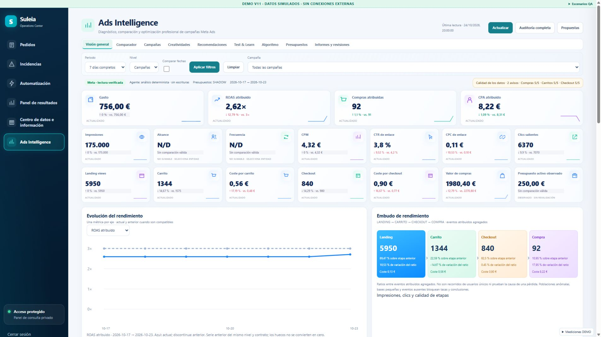
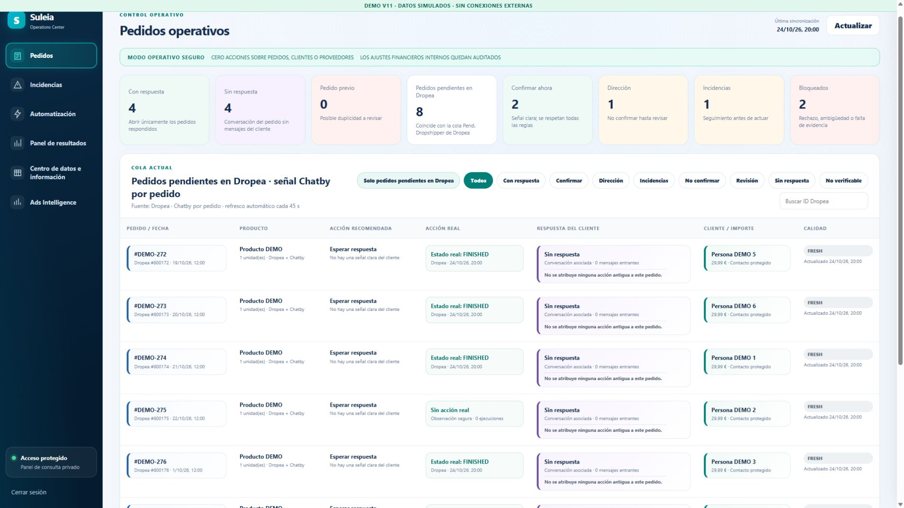
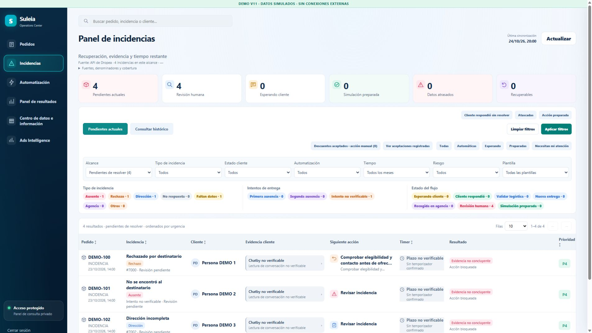
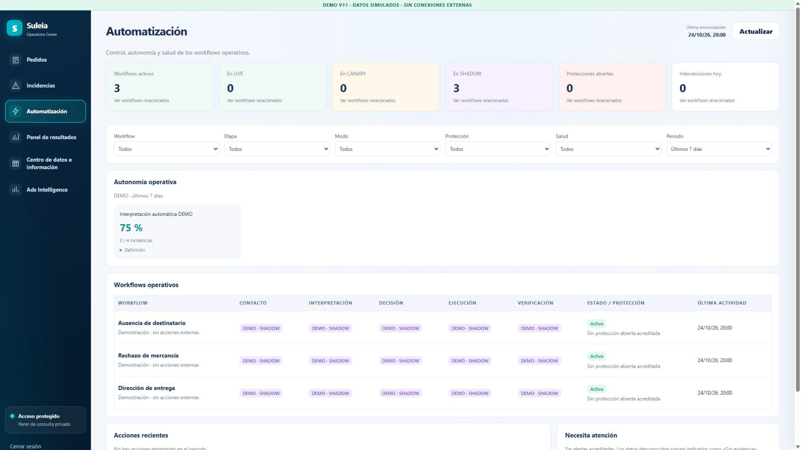
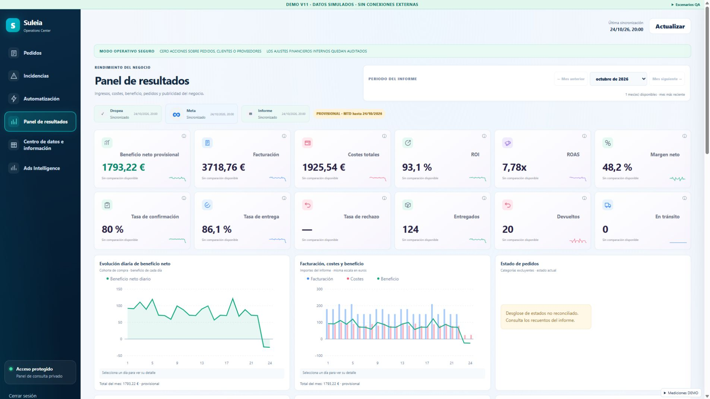
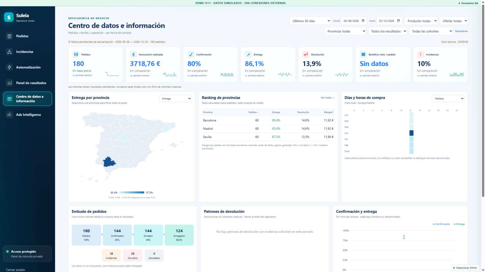
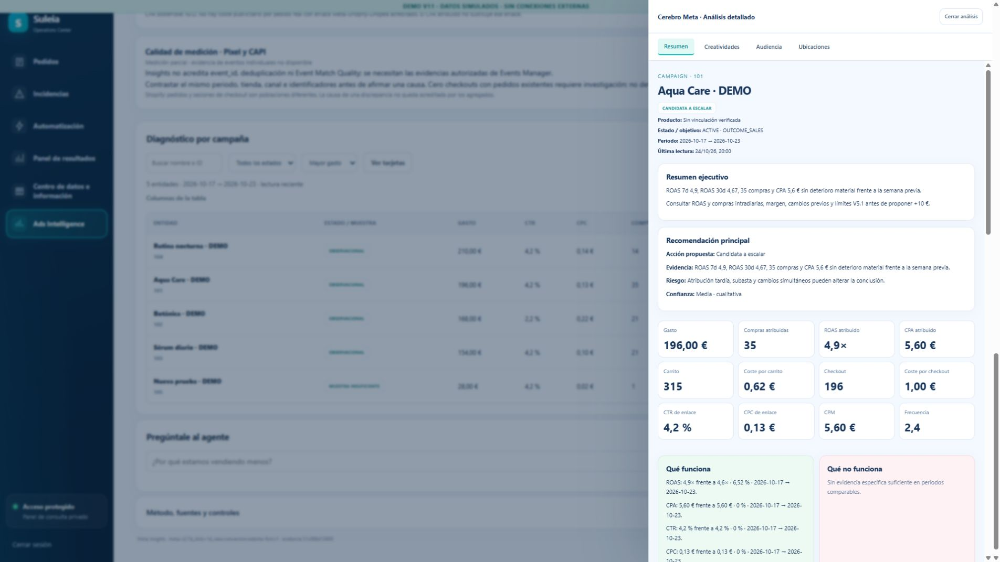

# V11 — evidencia de validación

**Candidato local; no desplegado.** Las imágenes de este documento contienen exclusivamente datos DEMO. La consulta productiva fue en lectura; no se publican conversaciones, teléfonos, credenciales ni capturas de clientes.

## Regresión final

25/10/2026: **1.291 pruebas correctas, cero fallidas, cero omitidas**, 142 archivos de prueba, 123,43 s. Archivo fuente probado SHA-256 `bf256b01b13169032b8f19a673e8c92552f0848c64dd48e48af5e348cee74542`. [Resultado](assets/operations-v11/acceptance.json).

Ejecutado con Node y PostgreSQL de las imágenes existentes en contenedores aislados: `network=none`, código montado en lectura, base y socket temporales, sin credenciales ni conexiones productivas, límites de memoria/CPU/PID. Se probaron API, panel, core financiero, MCP, Meta/report/review/growth/autopilot, Command Center y Telegram. El helper apagó su PostgreSQL y eliminó su volumen; no reinició servicios reales.

La ejecución anterior tuvo un fallo transitorio en la prueba MCP existente de timeout 100 ms frente a operación de 150 ms bajo CPU limitada. No se modificó su código ni se relajó la aserción. La ejecución final completa pasó también esa prueba. Se conservan ambos registros privados en el directorio de trabajo, sin ocultar el intento anterior.

Artefacto runtime `3333429b7f3718d05136e89acbea56fe89b740ba`: overlay de once módulos construido sobre el image ID productivo auditado y probado sin red/credenciales. Import de runtime correcto y 30 hashes verificados dentro de la imagen (once archivos nuevos/modificados y 19 protegidos). La imagen candidata `suleia-operations-v11:3333429`, ID `sha256:c7b5dcab1e1f948e054c8dfa1eeb7f549d379381f71dd53122d9c9803757b59b`, no se conectó al servicio real. [Recibo](assets/operations-v11/overlay-build.json) · [Manifiesto y hashes de ambos paquetes](OPERATIONS_CENTER_V11_RELEASE.json).

Cobertura específica añadida:

- Cola crítica/analítica, prioridad y concurrencia reservada, expiración/overflow, cabeceras saneadas, código 17 y Retry-After, pausa compartida sin bypass por force.
- Cinco consultas simultáneas de entidades comparten los tres Insights por contrato; caché no renueva la fecha de origen, no retiene fallos ni cachea revalidaciones financieras críticas.
- Restauración SQL del corte existente, aislamiento cuenta/contrato/nivel/rango, datos antiguos siempre históricos, memoria y trabajos acotados.
- Histórico lento/fallido conserva resumen y no fabrica decisión; bloques metadata/commerce independientes; espera ejecutiva acotada; unión exacta de creatividades.
- Cobertura parcial, totales/subtotales, ratios ponderados, identidades de compra, series/huecos y comparación compatible.
- Cliente: timeout frente a cancelación, conservación de progreso, force eliminado al sondear PREPARING, ningún sondeo inmediato de FAILED por cuota.
- Refresco de fondo difiere mientras se edita un filtro o se lee evidencia desplegada; actualización manual sigue funcionando.
- Contratos financieros, OAuth/RBAC, ledgers, confirmaciones, idempotencia, política/ejecutor V5.1 e informes Telegram existentes.

## Rendimiento controlado antes/después

Mismo recorrido: overview de campañas, calentamiento de metadata, 20 lecturas calientes, growth e inspección de cinco entidades. Cliente y runtime reales contra Graph sintético de cinco campañas, una página, sin red externa. No es una medición p95 de Meta productivo ni una promesa de latencia de red. [Mediciones](assets/operations-v11/benchmarks.json).

| Medida | Base V10 | V11 |
| --- | ---: | ---: |
| GET totales del recorrido | 40 | 19 |
| GET Insights | 28 | 12 |
| GET iniciales antes de publicar resumen | 19 | 6 |
| Overview frío, proveedor 20 ms | 527,95 ms | 168,50 ms |
| Overview frío, proveedor 200 ms | 3.077,57 ms | 1.088,96 ms |
| Growth frío, proveedor 20 ms | 449,09 ms | 183,40 ms |
| Growth frío, proveedor 200 ms | 3.040,75 ms | 1.272,46 ms |
| p95 de 20 lecturas calientes, proveedor 20 ms | 1,40 ms | 1,23 ms |
| p95 caliente, proveedor 200 ms | 3,18 ms | 1,99 ms |

V11 publica el resumen antes de los extras: el calentamiento opcional posterior tardó 77,52 ms / 620,84 ms y dos GET a 20/200 ms respectivamente. Está incluido en los 19 GET totales; no se esconde ese trabajo. La base ya tenía caché caliente rápida. La mejora principal es el camino frío y las consultas redundantes evitadas. Primer análisis individual a 200 ms: 1.076,10 ms / cinco GET; los cuatro siguientes reutilizaron la lectura y no hicieron GET adicionales. Máximo concurrente observado en ese recorrido secuencial: uno; el límite y reserva de dos se prueban en los tests de carga.

Navegador real Chrome, localhost DEMO, una observación de navegación: TTFB 8 ms, LCP 388 ms, CLS 0,0452; 15 solicitudes API locales, p95 55 ms. No son percentiles poblacionales de navegación ni mediciones productivas. No se dispone de una LCP comparable anterior. [Muestra](assets/operations-v11/browser-metrics.json).

## QA visual e interacción

Excepción de navegador del dueño: pruebas locales DEMO y panel productivo solo en lectura. No se inició ningún mensaje, presupuesto, acción logística o llamada pagada de OpenAI.

| Vista DEMO | Comprobación |
| --- | --- |
| Pedidos | Ocho filas, filtros y mismo menú |
| Incidencias | Cuatro casos, evidencia/temporizadores/estados y avisos visibles; captura móvil sin overflow global |
| Automatización | Tres flujos sintéticos SHADOW; sin ejecución |
| Panel de resultados | Cohorte sintética 180 creados, 144 enviados, 124 entregados y 20 devueltos; ingresos 3.718,76 €, costes 1.925,54 €, beneficio 1.793,22 €; datos calculados con funciones reales |
| Centro de datos | 180 hechos sintéticos y gráficas/series reales del agregador |
| Ads | 18 tarjetas, evolución SVG, embudo, decisiones fundamentadas, tabla/tarjetas, filtros y selector de columnas |

Interacciones verificadas: campaña 101, conjunto 201 y anuncio 3010 conservan identidad; campaña Aqua Care a 14 días muestra 392 €/70 compras frente a 196 €/35 compras a siete días. Sus ventanas de decisión 7/30 días se etiquetan separadamente. Búsqueda Botánica deja una sola fila; columnas muestran Impresiones; Escape cierra el drawer y restaura foco; opcional Audiencia sin datos explica la ausencia conservando el resumen. No se ejecutaron los botones de registro, propuesta o envío.

Errores ejercitados mediante controles visibles del harness: histórico de siete segundos con resumen disponible; Meta código 17 sin bucle; fuente histórica con decisiones bloqueadas; fallo opcional conserva métricas y reintento; rechazo de credencial Meta muestra diagnóstico dentro del panel sin cerrar la sesión Suleia. La sesión DEMO se renovó por su OAuth sintético cuando expiró; no se extrajeron cookies o credenciales productivas.

Responsive: se usaron viewports CSS reales de iframe en Chrome, **no dispositivos físicos ni emulación móvil nativa**. El wrapper identifica sus dimensiones y aparece en las capturas. El override de viewport del navegador no cambió de tamaño en este proveedor, por lo que no se usa como prueba. Se verificó `scrollWidth === clientWidth` del documento interno en 1440×900 (1425 px útiles), 1366×768 (1351), tablet 820×1180 (805) y móvil 390×844 (375); la diferencia de 15 px es la barra vertical. No hubo overflow horizontal global; tablas y comparadores mantienen su scroll interno. Menú móvil accesible y 18 KPIs presentes.

Las nueve pestañas internas siguen conectadas a sus propietarios y las cubre la regresión de contratos. El harness visual no simula todos los endpoints privados de Algoritmo/Presupuestos/Informes; no se presenta como una prueba productiva completa de esos subsistemas. El ejecutor financiero y las entregas se auditan por su ledger real, sin canario monetario forzado.

### Capturas de las seis secciones

| Pedidos | Incidencias |
| --- | --- |
|  |  |
| Automatización | Resultados |
|  |  |

### Análisis y pantallas pequeñas

[Conjunto](assets/operations-v11/drawer-adset-demo.jpg) · [Anuncio](assets/operations-v11/drawer-ad-demo.jpg) · [Periodo 14 días](assets/operations-v11/drawer-period-context-demo.jpg) · [1440](assets/operations-v11/ads-1440-demo.jpg) · [1366](assets/operations-v11/ads-1366-demo.jpg) · [Tablet](assets/operations-v11/ads-tablet-demo.jpg) · [Móvil Ads](assets/operations-v11/ads-mobile-demo.jpg) · [Móvil Incidencias](assets/operations-v11/incidents-mobile-demo.jpg).

### Degradación ante fuentes externas

[Cuota Meta](assets/operations-v11/meta-rate-limit-demo.jpg) · [Fallo opcional](assets/operations-v11/optional-failure-demo.jpg) · [Histórico](assets/operations-v11/stale-demo.jpg) · [Carga progresiva](assets/operations-v11/progressive-demo.jpg) · [Credencial Meta](assets/operations-v11/meta-auth-demo.jpg).

## Lectura productiva y criterios pendientes

Se consultaron las seis vistas productivas con OAuth personal: Pedidos 17 filas visibles, Incidencias diez, Automatización seis flujos, Centro de datos nueve SVG, Resultados 36 SVG y 33/33 controles. Ads pasó de PREPARING a datos históricos. Se dejó la pestaña del usuario en su vista financiera original. Cero escrituras/mensajes de prueba; capturas y texto de clientes se mantienen fuera del repositorio.

El candidato resuelve en pruebas las causas del exceso de lecturas, espera/borrado de contenido y fragmentación visual. **La frescura y recuperación de cuota en producción siguen pendientes de desplegar V11 y comprobar una lectura actual real.** La auditoría halló cero modificaciones presupuestarias verificadas y canario pendiente; no se afirma que el automatismo ya esté realizando cambios. El siguiente informe Telegram debe comprobarse en su envío natural, no duplicarlo como smoke. Pixel/CAPI/EMQ, enlace pedido-campaña y beneficio atribuible siguen sin evidencia suficiente.

Cierre 10:19 UTC: tras construir el candidato, producción conserva API7224c11, estáticos b048ad5 y 108/108 hashes. Aparece un nuevo slot FAILED a las 11:00 Madrid con `AUTOPILOT_REVIEW_FAILED` y `externalWrites:null`; su catch no registra la excepción causante. No se atribuye ese fallo al código 17 histórico. Siguen cero eventos VERIFIED, cero operaciones UNKNOWN/EXECUTING y canario pendiente. La imagen candidata no se desplegó ni se reejecutó el slot.
